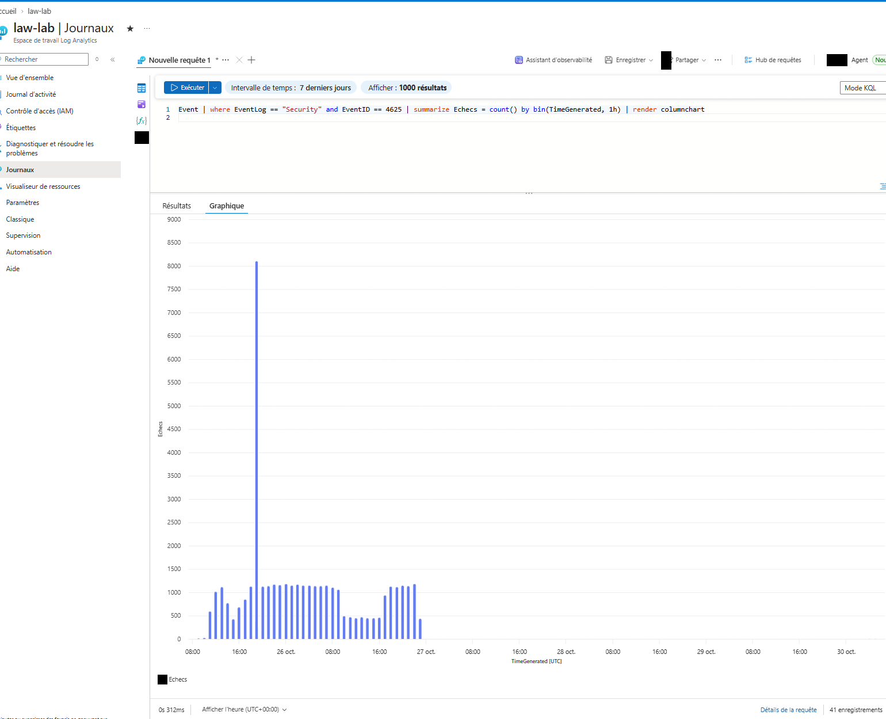
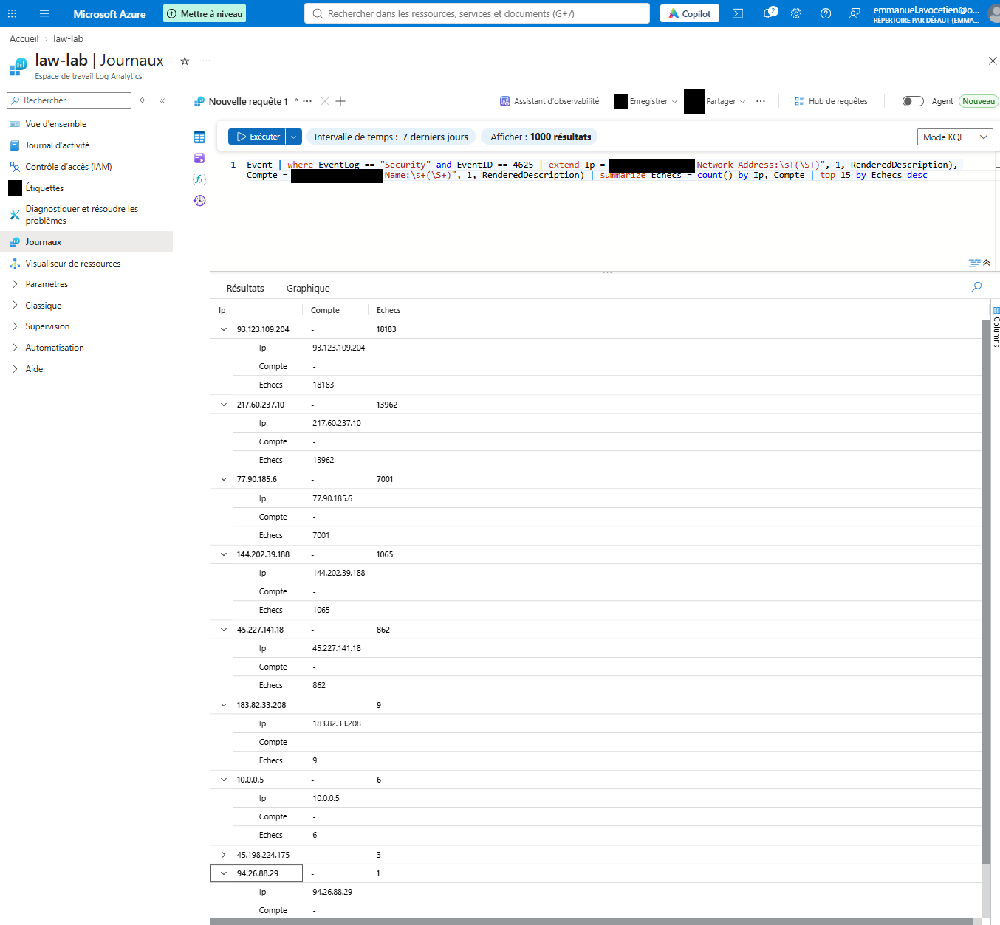
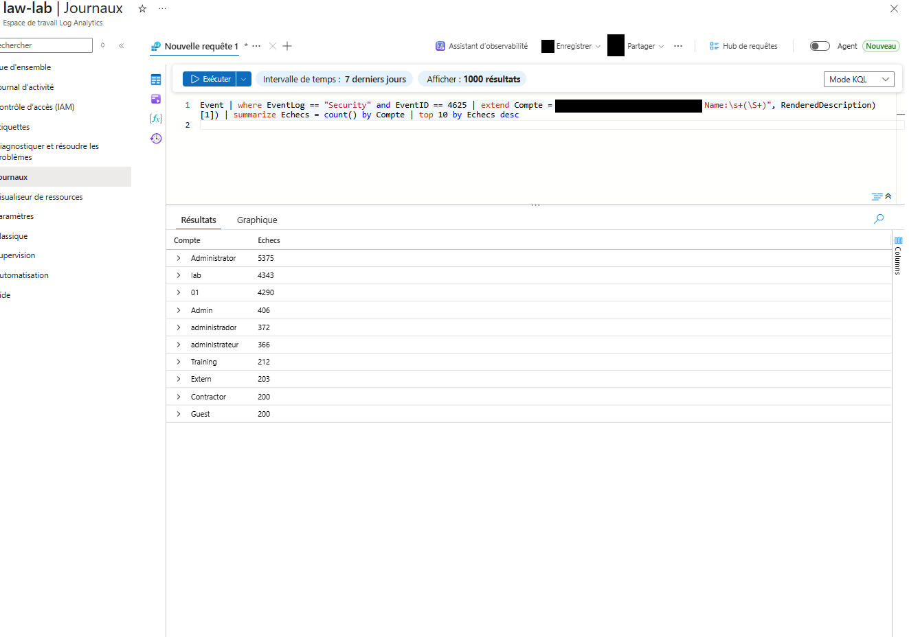
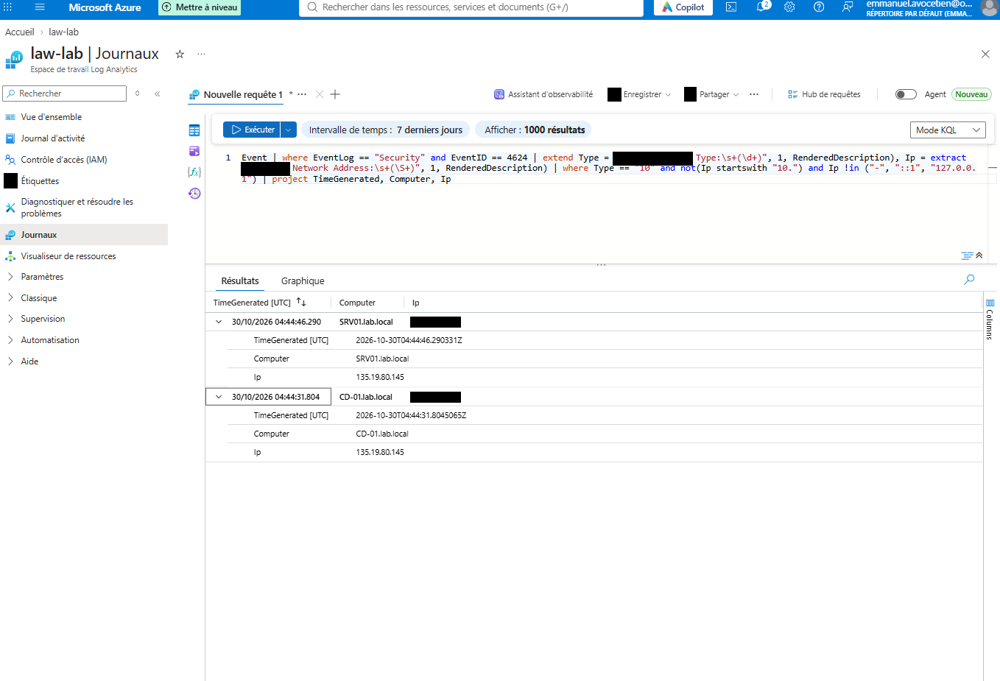
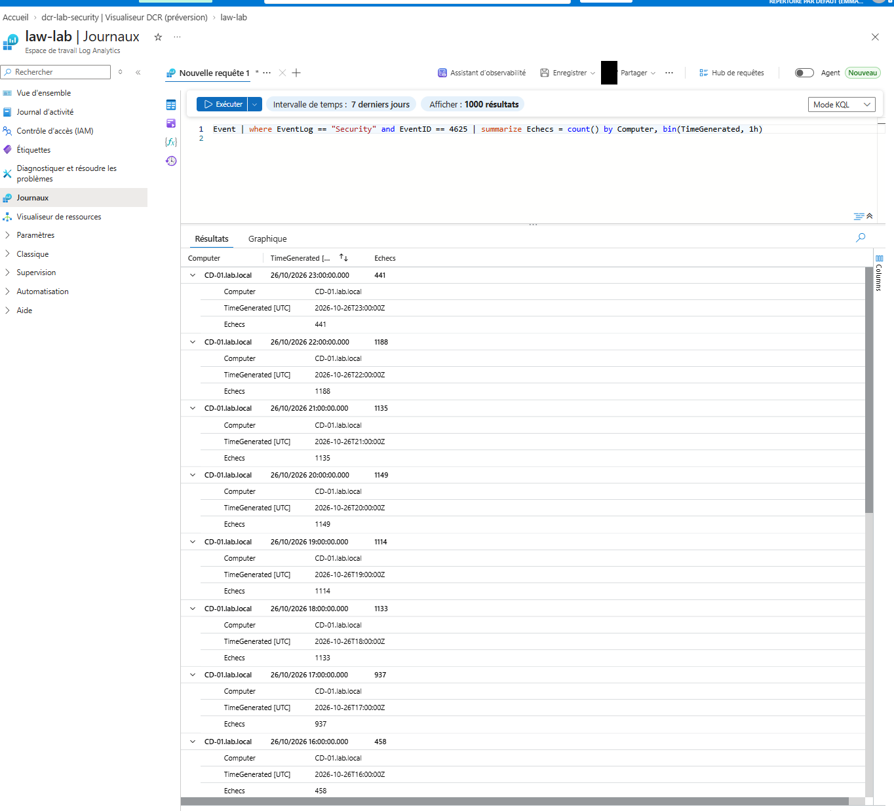
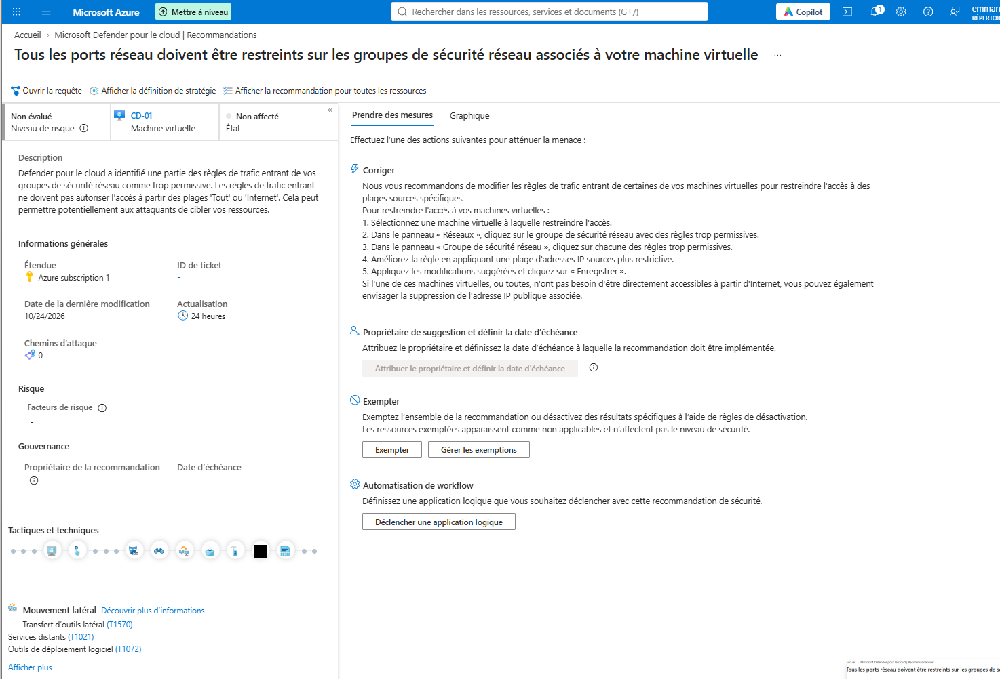
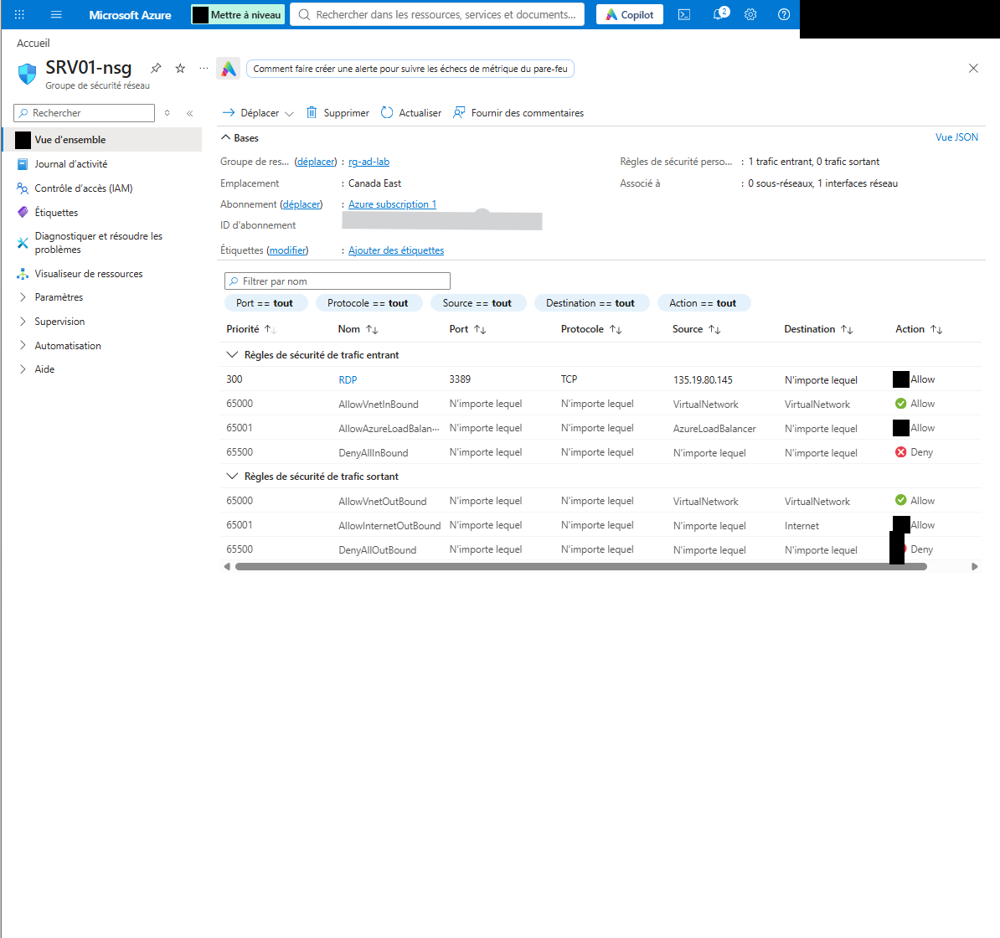

# Rapport d'incident — Attaque par force brute RDP sur un lab Azure

**Auteur :** Emmanuel Avocetien · **Période :** 25–26 octobre 2026 (détection le 30 octobre) · **Gravité :** moyenne (tentatives massives, aucun accès obtenu) · **Statut :** clos

## 1. Résumé
Une règle du groupe de sécurité réseau (NSG) autorisait le RDP (3389) depuis **n'importe quelle adresse (Any)**. Des robots d'Internet ont lancé environ **40 000 tentatives de connexion** sur le contrôleur de domaine `CD-01`. L'analyse des journaux montre **aucune connexion externe réussie**. La règle a été restreinte à une seule adresse IP.

## 2. Chronologie (UTC)
| Date | Événement |
|---|---|
| Création des VM | RDP ouvert à « Any » |
| 25 oct. | Début des échecs de connexion, environ 1 000 par heure |
| 26 oct. fin de journée | Pic d'environ 8 000 échecs en une heure ; arrêt des données vers 23 h |
| 27–30 oct. | Aucune donnée (VM arrêtées pour gerer le budget) |
| 30 oct. | Détection par requête KQL, investigation, restriction du NSG |
| 30 oct. | 24 h après correction : 9 échecs, tous issus de mes tests |

## 3. Détection
Événement Windows **4625** (échec d'ouverture de session) collecté par l'agent Azure Monitor dans `law-lab`.
```kql
Event | where EventLog == "Security" and EventID == 4625
| summarize Echecs = count() by bin(TimeGenerated, 1h) | render columnchart
```


## 4. Analyse
**Sources principales (IP publiques d'attaquants) :**
| IP source | Échecs |
|---|---|
| 93.123.109.204 | 18 183 |
| 217.60.237.10 | 13 962 |
| 77.90.185.6 | 7 001 |
| 144.202.39.188 | 1 065 |
| 45.227.141.18 | 862 |



**Comptes visés :** `Administrator` (5 375), `Admin` (406), `administrador` (372), `administrateur` (366), `Training`, `Extern`, `Contractor`, `Guest` (~200 chacun). Ce sont des noms génériques d'un dictionnaire multilingue. Les entrées `lab` (4 343) et `01` (4 290) sont à interpréter avec prudence : l'extraction par expression régulière peut capter un autre champ du message.


**Comptes réels non ciblés :** `cdadmin` (1 échec) et `atest` / `Atest` (8 échecs) correspondent à **mes propres tests volontaires**. Mon compte administrateur n'a pas été visé.

**Connexions réussies depuis l'extérieur (événement 4624, type 10, IP non interne) :** deux résultats, sur `CD-01` et `SRV01`, tous deux depuis **mon adresse IP** (vérifiée). **Aucune compromission détectée.**


## 5. Cause racine
Règle NSG RDP avec source « Any ». Defender for Cloud a aussi émis la recommandation « tous les ports réseau doivent être restreints sur les NSG associés à votre VM ».



## 6. Confinement et remédiation
1. Règle RDP des NSG modifiée : source = **mon adresse IP publique** uniquement (mesure appliquée).
2. Vérification par le même graphique 24 h plus tard : plus d'échecs externes.
3. Mots de passe administrateur vérifiés (longs, uniques, hors dictionnaire).



## 7. Recommandations (non appliquées dans le lab)
- Politique de verrouillage de compte (GPO) et authentification forte (MFA).
- Supprimer l'exposition directe : Azure Bastion ou accès JIT.
- Règle d'alerte (ex. Microsoft Sentinel) sur un pic d'événements 4625.
- Revue régulière des recommandations Defender for Cloud.

## 8. Correspondance MITRE ATT&CK
`T1110` Brute Force · `T1133` External Remote Services · `T1078` Valid Accounts (tentée, non aboutie)

## 9. Limites
Les VM étaient arrêtées du 27 au 30 octobre ; l'effet de la correction est démontré par la période où elles ont tourné après la restriction. Les noms `lab` et `01` n'ont pas été confirmés comme comptes ciblés.
