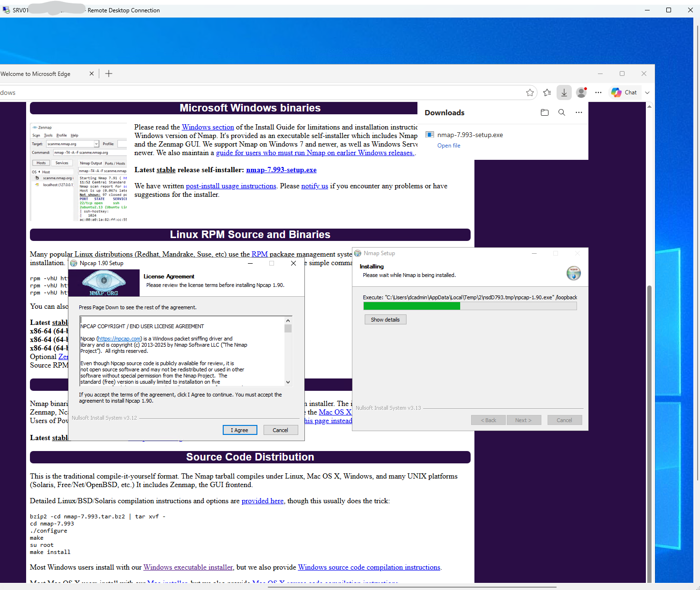
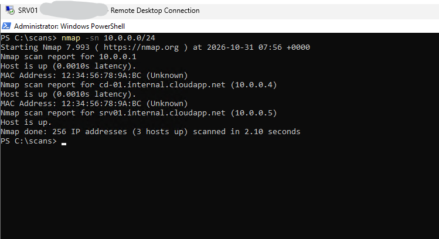
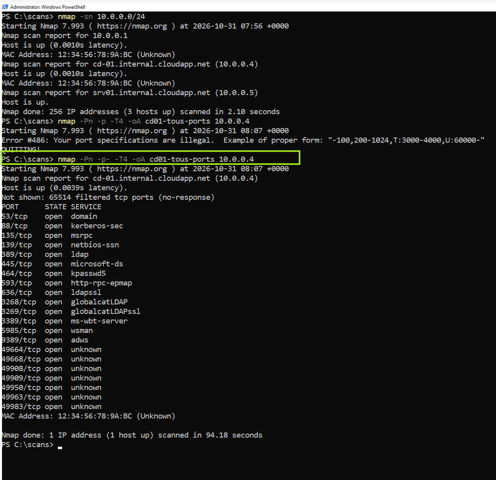
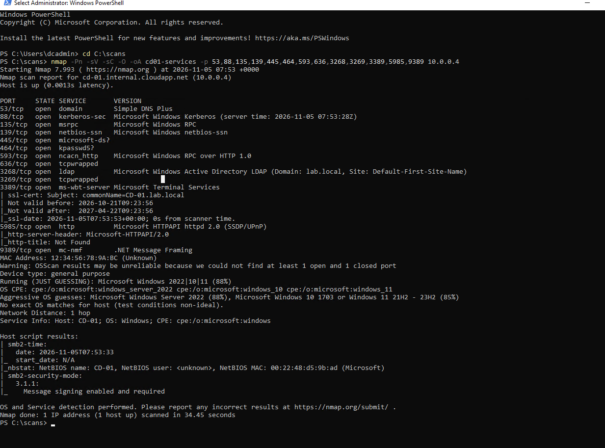
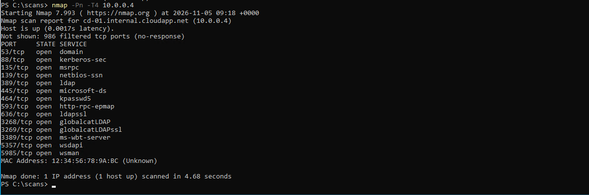
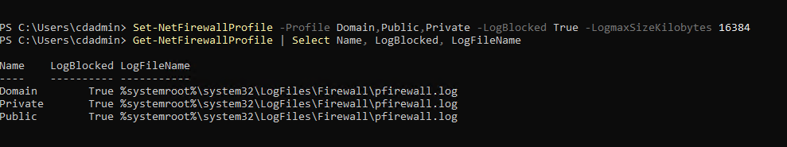

# Projet 2 — Reconnaissance réseau avec Nmap (lab Active Directory dans Azure)

**Emmanuel Avocetien** · [LinkedIn](https://www.linkedin.com/in/fofoprio) · Suite du [Projet 1](../projet-1-ad-cloud-monitoring/README.md)

> **EN summary:** From a member server (`SRV01`), I used Nmap to discover hosts, map open ports, fingerprint services/versions and read what an attacker learns about my Windows Server 2022 domain controller (`CD-01`) without credentials. I then ranked the risks and proposed fixes. Scans were run only against my own lab, internally.

## Objectif
Voir mon propre contrôleur de domaine **comme un attaquant** (énumération), puis le défendre : savoir ce qui est exposé, l'évaluer et recommander des mesures. Technique MITRE ATT&CK : **T1046** (découverte de services réseau) et **T1018** (découverte de systèmes distants).

## Cadre et éthique
Scans **internes** depuis `SRV01` (10.0.0.5) vers `CD-01` (10.0.0.4), dans mon propre lab Azure. Aucune machine tierce n'a été scannée.

## Compétences démontrées
`Nmap (-sn, -p-, -sV, -sC, -O)` · `Énumération de services` · `Active Directory (ports et protocoles)` · `Analyse de risque` · `Durcissement` · `Lecture critique des résultats`

## Étapes et résultats

### 1. Installation de Nmap sur `SRV01`
Nmap 7.993 depuis nmap.org, avec le pilote Npcap (capture de paquets).


### 2. Découverte des machines
```powershell
nmap -sn 10.0.0.0/24
```
**3 hôtes** répondent : `10.0.0.1` (passerelle virtuelle d'Azure), `CD-01` (10.0.0.4) et `SRV01` (10.0.0.5, la machine locale). En 2 secondes, le scan révèle aussi les noms des machines.


### 3. Scan de tous les ports de `CD-01`
```powershell
nmap -Pn -p- -T4 -oA cd01-tous-ports 10.0.0.4
```
**21 ports ouverts, 65 514 « filtered »** (le pare-feu Windows ignore les paquets sans répondre), en 94 secondes. La capture montre aussi ma première erreur (`-p` sans valeur, erreur n°486), corrigée en `-p-`.


### 4. Services, versions et système
```powershell
nmap -Pn -sV -sC -O -oA cd01-services -p 53,88,135,139,445,464,593,636,3268,3269,3389,5985,9389 10.0.0.4
```
Informations obtenues **sans identifiants** :
| Information | Source |
|---|---|
| Domaine `lab.local`, site `Default-First-Site-Name` | LDAP du catalogue global (3268) |
| Nom `CD-01.lab.local`, certificat auto-signé valable du 21/10/2026 au 22/04/2027 | Bureau à distance (3389) |
| Nom NetBIOS `CD-01` | Script `nbstat` |
| **Signature SMB activée et exigée** (SMB 3.1.1) — point favorable | Script `smb2-security-mode` |
| Système probable : Windows Server 2022 (88 %) | Détection d'OS (peu fiable : presque tous les ports sont filtrés) |



### 5. Scan court (1 000 ports courants)
```powershell
nmap -Pn -T4 10.0.0.4
```
14 ports ouverts, 986 filtrés. Un port **5357 (`wsdapi`, découverte d'appareils)** apparaît, absent du scan complet du 31 octobre. La cause n'est pas confirmée (hypothèse : service démarré entre-temps).


## Tableau de risques
| Port | Service | Rôle | Niveau | Risque | Recommandation |
|---|---|---|---|---|---|
| 445 | SMB | Partage de fichiers, communications AD | **Élevé** | Accès non autorisé aux fichiers, propagation de ransomware, mouvement latéral | Ne jamais exposer à Internet; limiter aux machines nécessaires; garder la signature SMB exigée (confirmée) |
| 3389 | RDP | Bureau à distance | **Élevé** | Force brute, vol d'identifiants (voir Projet 1 : ~40 000 tentatives) | Restreindre la source (NSG), Azure Bastion ou JIT, NLA, MFA; surveiller les événements 4624, 4625, 4778 |
| 5985 | WinRM (HTTP) | Administration PowerShell à distance | **Élevé** | Exécution de commandes à distance si un compte est compromis | Limiter qui peut se connecter (groupe, pare-feu), journaliser PowerShell; WinRM HTTPS (5986) surtout hors domaine |
| 139 | NetBIOS | Protocole hérité | Moyen | Inutile en SMB moderne; facilite l'énumération et certaines attaques de réseau local | Désactiver après avoir vérifié les dépendances |
| 389, 3268 | LDAP, catalogue global | Annuaire | Moyen | Révèle le domaine, permet l'énumération des objets | Limiter l'accès réseau; préférer LDAPS (636, 3269) avec certificat valide |
| 636, 3269 | LDAPS | Annuaire chiffré | Moyen | Réponse « tcpwrapped » : certificat probablement absent (hypothèse non vérifiée) | Installer un certificat (autorité de certification) |
| 88, 464 | Kerberos | Authentification | Moyen | Cible d'attaques comme le Kerberoasting | Mots de passe longs pour les comptes de service, surveillance des demandes de tickets |
| 53 | DNS | Résolution de noms | Faible à moyen | Révèle la structure du domaine | Limiter les transferts de zone |
| 135, 593 + ports 49664 et suivants | RPC | Appels de procédure, réplication AD | Faible à moyen | Surface d'énumération | Filtrer entre sous-réseaux |
| 9389 | AD Web Services | Outils d'administration AD | Faible à moyen | Canal d'administration | Restreindre aux postes d'administration |
| 5357 | WSDAPI | Découverte d'appareils | Faible à moyen | Inutile sur un contrôleur de domaine | Désactiver le service s'il n'est pas utilisé |

> Les trois lignes « Élevé » reprennent mon analyse personnelle; les autres lignes ont été rédigées avec une aide et restent à relire.

## Détection : ce que j'ai tenté et observé
J'ai voulu retrouver mon propre scan dans les journaux de `CD-01`.
- Journal texte du pare-feu : activé (`LogBlocked : True`, confirmé dans le réglage effectif), mais le fichier `pfirewall.log` est resté à l'**en-tête seul (212 octets)** après le scan. **Cause non confirmée.**
- Audit « Filtering Platform Packet Drop » (événement 5152) : activé quelques minutes; 4 événements relevés, **non analysés en détail**.
- Ma règle de collecte du Projet 1 n'envoie que 6 types d'événements (4624, 4625, 4720, 4728, 4732, 4740). Je **déduis** que le scan n'apparaît pas dans Log Analytics (non testé).


## Ce que j'ai appris
- Le nombre de ports ouverts d'un contrôleur de domaine est élevé par conception : on réduit le risque en **filtrant qui peut y accéder**, pas en les fermant.
- Un scan « filtered » partout rend la détection de version et d'OS moins fiable.
- Un pare-feu qui ignore les paquets ralentit un scan, mais ne le rend pas invisible : encore faut-il journaliser.

## Limites et suite
Détection du scan non démontrée (voir ci-dessus). Pistes : collecter l'ID 5152 ou les journaux de flux du réseau virtuel dans Log Analytics (attention au volume et au coût), tester le durcissement avant/après, comparer avec des machines RHEL.
